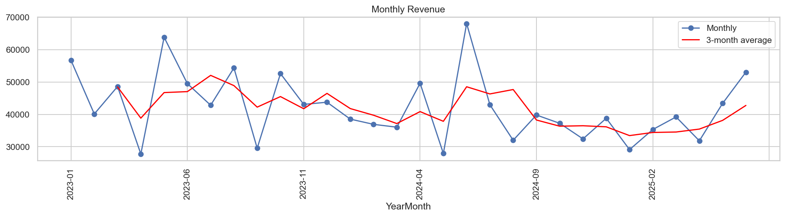
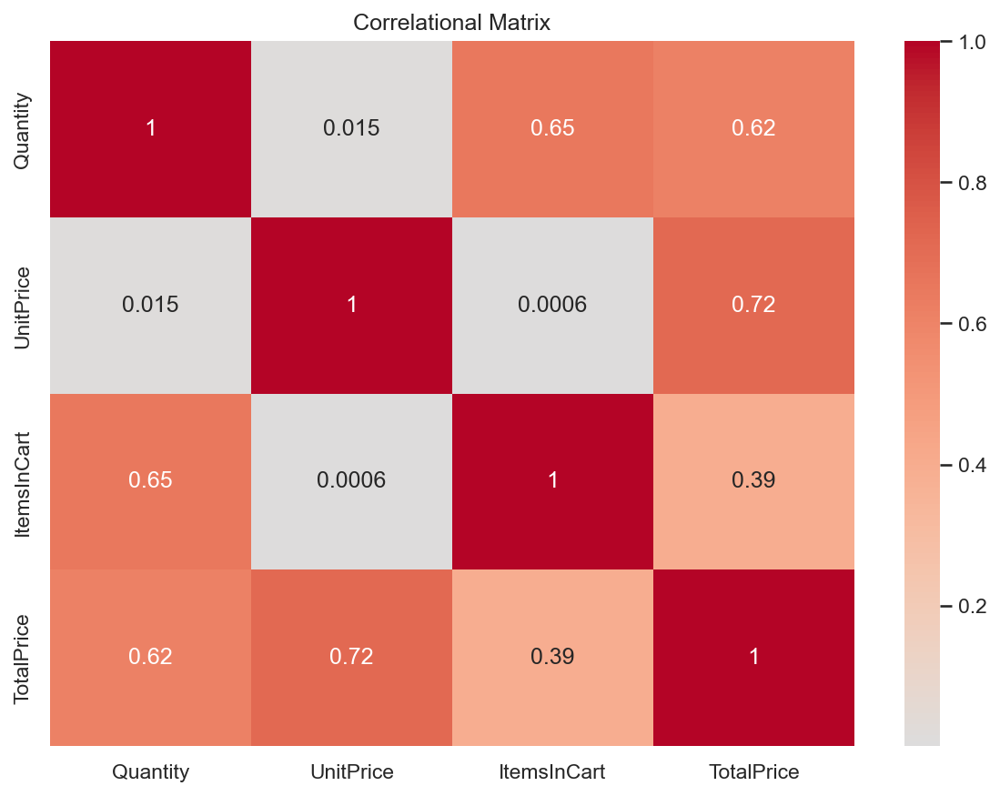

# Project 2: Exploratory Data Analysis (EDA) | DecodeLabs Data Analytics Internship

## Overview
EDA of 1,200 e-commerce orders (Jan 2023 - Jun 2025): statistics, outliers, trends and correlations.

## Key Findings
- Revenue is right-skewed (mean 1054 vs median 824)
- 8 high-value outliers (IQR method), all valid bulk orders
- H1 revenue fell ~10% year over year (2023 -> 2025)
- 41% of orders are Cancelled or Returned
- Strongest driver of TotalPrice: UnitPrice (r = 0.72)

## Tools
Python, Pandas, NumPy, Matplotlib, Seaborn

## How to Run
pip install -r requirements.txt
jupyter notebook EDA_Project2.ipynb

## Sample Visuals

